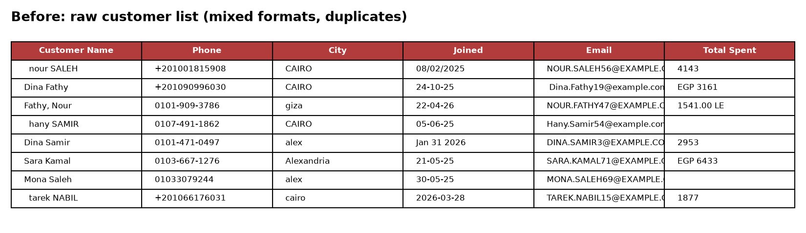
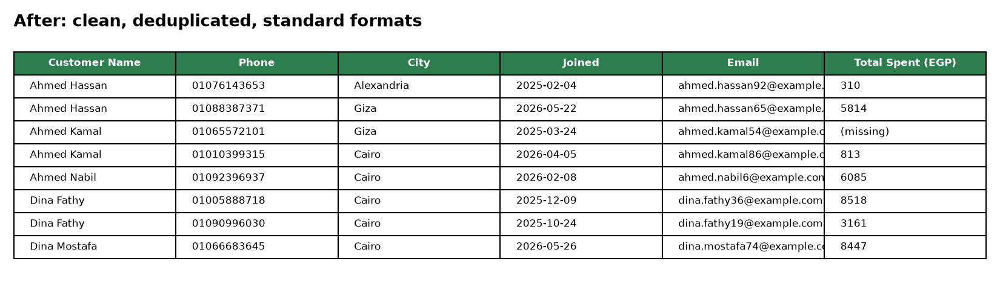
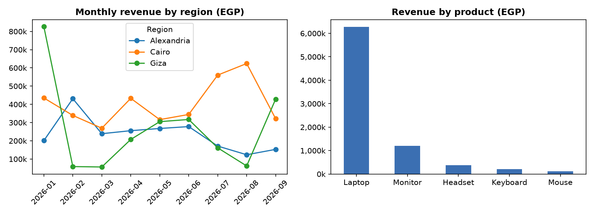

# Excel Data Cleaning and Dashboard Samples

Two sample jobs, built on fake data, to show what I deliver.

## 1. Customer list clean-up

`sample1_customer_data_cleaning.xlsx` - sheets: Before (raw), After (clean), Summary.

Fixed: extra spaces and mixed case in names, "Last, First" names, five date formats,
phone numbers in different styles, city spelling (alex / Alexandria), amounts with
"EGP" or "LE" text, and duplicate customers.

| Before | After |
|---|---|
|  |  |

## 2. Sales report and dashboard

`sample2_sales_report.xlsx` - sheets: Dashboard, Raw data, Monthly by region, By product.
Formulas and charts update when you paste new raw data.

## The service

- Clean messy Excel, CSV or Google Sheets data (duplicates, dates, names, phones, split / merged columns)
- Excel reports with formulas, pivot tables and charts
- I send a sample on part of your data first, then the full file with notes
- Small jobs are usually done within 24 hours

Hire me: [Fiverr](https://www.fiverr.com/haithamashraf)
Templates: [haithameldesouky.gumroad.com](https://haithameldesouky.gumroad.com)

All names, emails and numbers in these files are fake (example.com).
